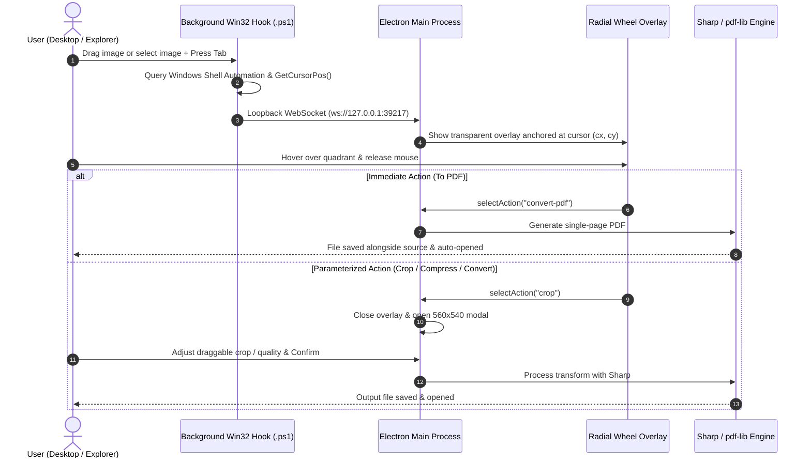

# 🌀 Action Wheel

<div align="center">

**A production-grade, premium Windows desktop utility for rapid image actions.**  
*Drag or select any image, press <kbd>Tab</kbd>, and execute high-speed image workflows right under your cursor.*

[](https://www.electronjs.org/)
[](https://react.dev/)
[](https://www.typescriptlang.org/)
[](https://tailwindcss.com/)
[](https://sharp.pixelplumbing.com/)
[](https://microsoft.com/windows)
[](LICENSE)

</div>

---

## 🌟 Overview

**Action Wheel** runs quietly in your Windows background. Whenever you start dragging an image file or have an image selected on your Desktop or in File Explorer, pressing <kbd>Tab</kbd> instantly projects a high-performance, dark-glass radial wheel anchored directly to your cursor coordinates. 

Hover over a segment and release your mouse to execute instant document conversions, format interchanges, interactive photo crops, or lossy/lossless compressions.

---

## ✨ Features

### 📄 To PDF *(12 o'clock)*
- Instantly packages the target image into a single-page vector PDF document using `pdf-lib` and `sharp`.
- Saves the output PDF right alongside the source file with non-destructive naming and automatically launches it in your default system viewer.

### 🔄 Format Conversion
- Effortlessly transcode images across modern formats: **WebP**, **PNG**, **JPG**, **AVIF**, and **TIFF**.
- Includes a fine-tuned encoding quality slider with automatic lossless handling for PNG outputs.
- Displays destination filename previews in real time.

### ✂️ Interactive Visual Crop
- Renders the image inside a dedicated canvas with **draggable and resizable 8-point bounding handles**.
- Interactive rule-of-thirds composition grid with dark background masking.
- Proportional **Aspect Ratio Presets**: **Freeform**, **1:1 Square**, **16:9 Wide**, and **4:3 Standard**.
- Calculates sub-pixel coordinates mapped back to the original image's full resolution.

### 🗜️ Smart Image Compression
- Features one-click tactile presets: **High (90%)**, **Balanced (75%)**, **Small (50%)**, and **Tiny (30%)**.
- Precision quality slider with live estimated file size reduction metrics (e.g. `~35%`, `~55%`, `~75%`).

### ✕ Zero-Latency Dismissal
- Releasing outside the wheel, clicking the center disk / cancel pill, or pressing <kbd>Esc</kbd> or <kbd>Tab</kbd> dismisses the wheel instantly without modifying your filesystem.

---

## 🎨 Design Philosophy

Inspired by the restraint of **Raycast**, the precision of **Linear**, and **Windows 11 Fluent Design**:
- **Controlled Translucent Surfaces:** Deep obsidian graphite bases (`rgba(14, 16, 21, 0.96)`) paired with subtle acrylic materials and fine hairline borders (`rgba(255, 255, 255, 0.08)`).
- **Multi-Layer Depth Shadows:** Dual-pass drop shadows that guarantee readability over bright, dark, or busy wallpapers.
- **Precision Iconography:** Pure vector SVG line icons designed with uniform `1.75` stroke weights — zero emoji bloat or mismatched iconography.
- **Snappy Motion Design:** Tight `0.14s` easing curves with zero spring jitter or latency during active dragging operations.

---

## 🏗️ Architecture & How It Works



1. **Native OS Interception:** A background process ([`scripts/drag-listener.ps1`](scripts/drag-listener.ps1)) monitors global input state via Win32 `GetAsyncKeyState`.
2. **Shell Resolution:** When <kbd>Tab</kbd> is triggered, it queries the Windows Shell COM Automation API (`Shell.Application`) to inspect focused items on Desktop or active Explorer windows.
3. **IPC Bridge:** Dispatches coordinate and file metadata over a local loopback WebSocket server to Electron.
4. **Renderer Overlay:** Spawns a frameless, screen-saver-level transparent canvas locked to the exact cursor coordinates.
5. **High-Speed Processing:** Dispatches operations to libvips-backed `sharp` and `pdf-lib` worker threads.

---

## 🛠️ Tech Stack

| Component | Technology |
| :--- | :--- |
| **Desktop Shell** | [Electron 31](https://www.electronjs.org/) + TypeScript, bundled with [`electron-vite`](https://electron-vite.org/) |
| **Frontend Framework** | [React 18](https://react.dev/) + [Framer Motion](https://www.framer.com/motion/) |
| **Styling** | [Tailwind CSS 3.4](https://tailwindcss.com/) + Custom Fluent Acrylic tokens |
| **Core Image Engine** | [`sharp`](https://sharp.pixelplumbing.com/) (High-performance libvips) |
| **PDF Generation** | [`pdf-lib`](https://pdf-lib.js.org/) |
| **Interactive Crop** | [`react-image-crop`](https://github.com/DominicTobias/react-image-crop) |
| **OS Automation** | C# P/Invoke via in-memory PowerShell + Windows Shell COM API |
| **Inter-Process Comm.** | Localhost [WebSocket](https://github.com/websockets/ws) (`127.0.0.1:39217`) + Electron `ipcMain`/`ipcRenderer` |

---

## 🚀 Getting Started

### Prerequisites
- **Windows 10 / 11** (64-bit)
- **Node.js**: v18.0.0 or higher
- **npm** or **pnpm**

### Installation

1. **Clone the repository:**
   ```powershell
   git clone https://github.com/RohanSingh7761/action-wheel.git
   cd action-wheel
   ```

2. **Install dependencies:**
   ```powershell
   npm install
   ```

3. **Start development mode:**
   ```powershell
   npm run dev
   ```

4. **Build production binaries:**
   ```powershell
   npm run build
   ```

---

## 📖 How to Use

1. Launch Action Wheel with `npm run dev` (it will initialize silently in your background and tray).
2. **Trigger the Wheel:**
   - **Method A (Drag gesture):** Click and hold any image file on your Desktop or in File Explorer, drag slightly, and press <kbd>Tab</kbd>.
   - **Method B (Selection):** Click/select any image file and tap <kbd>Tab</kbd>.
3. Move your cursor into one of the four quadrants:
   - **Top (12 o'clock):** `To PDF`
   - **Right (3 o'clock):** `Convert Format`
   - **Bottom (6 o'clock):** `Crop Image`
   - **Left (9 o'clock):** `Compress Image`
4. Release the mouse button over your desired segment to execute.
5. Tap <kbd>Esc</kbd> or <kbd>Tab</kbd> at any point to dismiss without performing any action.

---

## 📁 Project Structure

```
action-wheel/
├── resources/              # App icons and sample assets
├── scripts/
│   └── drag-listener.ps1   # Native Win32 drag & shell listener hook
├── src/
│   ├── main/               # Electron main process
│   │   ├── index.ts        # App entry, WebSocket server & daemon spawner
│   │   ├── processor/      # Sharp & pdf-lib action processing pipelines
│   │   └── windows/        # Overlay, Popup, and Hub window controllers
│   ├── preload/            # Context-isolated IPC preload scripts
│   ├── renderer/           # React 18 UI
│   │   ├── hub/            # Control hub / drop-zone window
│   │   ├── overlay/        # Radial Action Wheel & toast notifications
│   │   ├── popup/          # Convert, Crop, and Compress parameter modals
│   │   └── shared/         # Precision Lucide-style SVG icon system
│   └── shared/
│       └── ipc-types.ts    # Single source of truth for IPC channels & actions
├── electron.vite.config.ts # electron-vite configuration
├── package.json
└── tailwind.config.js
```

---

## 📄 License

This project is licensed under the MIT License — see the [LICENSE](LICENSE) file for details.
