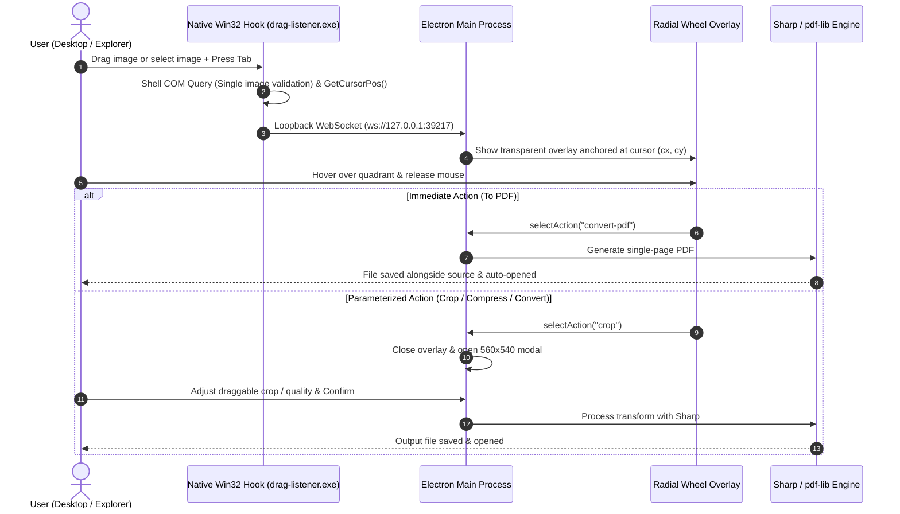

# 🌀 Action Wheel

<div align="center">

**A production-grade, lightning-fast radial image utility for Windows 10 & 11.**  
*Drag or select any image, press <kbd>Tab</kbd>, and execute high-speed image workflows right under your cursor.*

[](https://github.com/RohanSingh7761/action-wheel/releases)
[-0078D6?style=flat-square&logo=windows&logoColor=white)](https://microsoft.com/windows)
[](https://www.electronjs.org/)
[](https://react.dev/)
[](https://www.typescriptlang.org/)
[](https://tailwindcss.com/)
[-99CC00?style=flat-square&logo=node.js&logoColor=white)](https://sharp.pixelplumbing.com/)
[](LICENSE)

<br />

<p align="center">
  <a href="https://github.com/RohanSingh7761/action-wheel/releases/latest/download/Action-Wheel-Setup-1.0.0.exe">
    
  </a>
  &nbsp;&nbsp;
  <a href="https://github.com/RohanSingh7761/action-wheel/releases/latest/download/Action-Wheel-1.0.0.exe">
    
  </a>
</p>

<p align="center">
  <a href="#-download--installation">Download Guide</a> •
  <a href="#-features">Features</a> •
  <a href="#-how-to-use">How to Use</a> •
  <a href="#-developer-setup">Developer Setup</a> •
  <a href="#%EF%B8%8F-architecture--antivirus-design">Antivirus Architecture</a>
</p>

</div>

---

## 🌟 Overview

**Action Wheel** runs quietly in your Windows background. Whenever you start dragging an image file or have an image selected on your Desktop or in File Explorer, pressing <kbd>Tab</kbd> instantly projects a high-performance, dark-glass radial wheel anchored directly to your cursor coordinates. 

Hover over a segment and release your mouse to execute instant document conversions, format interchanges, interactive photo crops, or lossy/lossless compressions.

- **Zero Clutter:** No windows open until you want them.
- **Microsecond Response:** Built on libvips multi-threaded image processing.
- **Native Precision:** Seamlessly detects active files across Windows Desktop and File Explorer via Shell Automation.
- **False-Positive Free:** Native ahead-of-time compiled C# Win32 background listener that bypasses Windows AMSI and third-party antivirus heuristic blocks.

---

## 📥 Download & Installation

You can get Action Wheel as either a **standard Windows installer** or a **portable standalone executable** (no installation needed).

| Package | Description | Direct Download |
| :--- | :--- | :--- |
| **Windows Installer** | Installs to `%LOCALAPPDATA%`, creates Start Menu shortcut, supports auto-updates and clean uninstaller. | [⬇️ **Download Installer (.exe)**](https://github.com/RohanSingh7761/action-wheel/releases/latest/download/Action-Wheel-Setup-1.0.0.exe) |
| **Portable Version** | Single standalone `.exe` you can put in any folder or USB drive. Run directly without installation. | [📦 **Download Portable (.exe)**](https://github.com/RohanSingh7761/action-wheel/releases/latest/download/Action-Wheel-1.0.0.exe) |

> [!NOTE]
> All releases and changelogs are also hosted on the [GitHub Releases Page](https://github.com/RohanSingh7761/action-wheel/releases).

---

### 🛡️ Windows SmartScreen & Antivirus Guide

Because Action Wheel is a free, community-driven open-source project, the executable is not signed with an enterprise EV (Extended Validation) code signing certificate (which costs hundreds of dollars annually).

#### 1. Windows Defender SmartScreen
When you first run the downloaded `.exe`, Windows Defender SmartScreen may display:
> *"Windows protected your PC — Microsoft Defender SmartScreen prevented an unrecognized app from starting."*

**To run the application:**
1. Click **"More info"** on the popup.
2. Click **"Run anyway"**.

```
┌─────────────────────────────────────────────────────────────┐
│ Windows protected your PC                                   │
│ Microsoft Defender SmartScreen prevented an unrecognized    │
│ app from starting. Running this app might put your PC at    │
│ risk.                                                       │
│                                                             │
│ [ More info ]  <── Click here                               │
│                                           [ Don't run ]     │
└─────────────────────────────────────────────────────────────┘
                            ▼
┌─────────────────────────────────────────────────────────────┐
│ App:    Action-Wheel-Setup-1.0.0.exe                        │
│ Publisher: Unknown publisher                                │
│                                                             │
│ [ Run anyway ] <── Click here             [ Don't run ]     │
└─────────────────────────────────────────────────────────────┘
```

#### 2. Antivirus (McAfee, Norton, Defender)
Earlier experimental versions of the drag detector relied on dynamic PowerShell scripts (`powershell.exe -ExecutionPolicy Bypass`), which heuristic antivirus scanners (like McAfee AMSI) occasionally flagged as suspicious script activity.

**In v1.0.0, this is completely solved:**
- We eliminated all runtime PowerShell script generation.
- The background hook is compiled ahead-of-time into a clean, 15 KB native Win32 executable (`resources/drag-listener.exe`).
- All code is 100% open-source and auditable right here in the repository.

---

## ✨ Features

### 📄 To PDF *(Top)*
- Instantly packages the target image into a single-page vector PDF document using `pdf-lib` and `sharp`.
- Saves the output PDF right alongside the source file with non-destructive naming and automatically launches it in your default system viewer.

### 🔄 Format Conversion *(Right)*
- Effortlessly transcode images across modern formats: **WebP**, **PNG**, **JPG**, **AVIF**, and **TIFF**.
- Fine-tuned encoding quality slider with automatic lossless handling for PNG outputs.
- Displays destination filename and size previews in real time.

### ✂️ Interactive Visual Crop *(Bottom)*
- Displays the image inside an interactive canvas with **draggable and resizable 8-point bounding handles**.
- Interactive rule-of-thirds composition grid with dark background masking.
- Proportional **Aspect Ratio Presets**: **Freeform**, **1:1 Square**, **16:9 Wide**, and **4:3 Standard**.
- Calculates sub-pixel coordinates mapped back to the original image's full resolution.

### 🗜️ Smart Image Compression *(Left)*
- One-click tactile presets: **High (90%)**, **Balanced (75%)**, **Small (50%)**, and **Tiny (30%)**.
- Precision quality slider with live estimated file size reduction metrics (e.g. `~35%`, `~55%`, `~75%`).

### 🛡️ Smart Gesture Protection
- **Single-Image Only:** If multiple files are selected or dragged simultaneously, Action Wheel remains dormant to prevent accidental batch processing.
- **Image-Only Filtering:** Non-image files (videos, documents, archives) are automatically filtered out.
- **Zero-Latency Dismissal:** Releasing outside the wheel, clicking the center cancel pill, or pressing <kbd>Esc</kbd> or <kbd>Tab</kbd> dismisses the wheel instantly without modifying your filesystem.

---

## 🎨 Design Philosophy

Inspired by the restraint of **Raycast**, the precision of **Linear**, and **Windows 11 Fluent Design**:
- **Controlled Translucent Surfaces:** Deep obsidian graphite bases (`rgba(14, 16, 21, 0.96)`) paired with subtle acrylic materials and fine hairline borders (`rgba(255, 255, 255, 0.08)`).
- **Multi-Layer Depth Shadows:** Dual-pass drop shadows that guarantee readability over bright, dark, or busy wallpapers.
- **Precision Iconography:** Pure vector SVG line icons designed with uniform `1.75` stroke weights — zero emoji bloat or mismatched iconography.
- **Snappy Motion Design:** Tight `0.14s` easing curves with zero spring jitter or latency during active dragging operations.

---

## 📖 How to Use

1. Launch Action Wheel (it runs quietly in your background and system tray).
2. **Trigger the Wheel:**
   - **Method A (Drag gesture):** Click and hold any image file on your Desktop or in File Explorer, drag slightly, and press <kbd>Tab</kbd>.
   - **Method B (Selection):** Click/select any image file and tap <kbd>Tab</kbd>.
3. Move your cursor into one of the four quadrants:
   - **Top:** `To PDF`
   - **Right:** `Convert Format`
   - **Bottom:** `Crop Image`
   - **Left:** `Compress Image`
4. Release the mouse button over your desired segment to execute.
5. Tap <kbd>Esc</kbd> or <kbd>Tab</kbd> at any point to dismiss without performing any action.

---

## 🏗️ Architecture & Antivirus Design



### Why It Doesn't Trigger Antivirus Heuristics
1. **Pre-compiled Win32 Executable:** Rather than invoking hidden PowerShell processes with `-ExecutionPolicy Bypass` at runtime, the background listener is compiled into `resources/drag-listener.exe` using Microsoft's standard .NET `csc.exe` with the `/target:winexe` subsystem.
2. **Strict Loopback Communication:** All IPC communication between the background hook and Electron uses an unexposed local loopback WebSocket bound solely to `127.0.0.1`.
3. **No DLL Injections:** Does not use invasive kernel hooks or global Windows API hooks (`SetWindowsHookEx`), ensuring total system stability and anti-cheat compatibility.

---

## 🛠️ Tech Stack

| Component | Technology |
| :--- | :--- |
| **Desktop Shell** | [Electron 31](https://www.electronjs.org/) + TypeScript, bundled with [`electron-vite`](https://electron-vite.org/) |
| **Frontend Framework** | [React 18](https://react.dev/) + [Framer Motion](https://www.framer.com/motion/) |
| **Styling** | [Tailwind CSS 3.4](https://tailwindcss.com/) + Custom Fluent Acrylic tokens |
| **Core Image Engine** | [`sharp`](https://sharp.pixelplumbing.com/) (High-performance libvips) |
| **PDF Generation** | [`pdf-lib`](https://pdf-lib.js.org/) |
| **Interactive Crop** | [`react-image-crop`](https://github.com/DominicTobias/react-image-crop) |
| **Native Background Hook** | Compiled Win32 C# daemon (`drag-listener.exe`) + Windows Shell COM API |
| **Packaging & Distribution**| [`electron-builder`](https://www.electron.build/) (NSIS Installer & Standalone Portable EXE) |

---

## 💻 Developer Setup

Want to run Action Wheel from source or contribute? Follow these steps:

### Prerequisites
- **Windows 10 / 11** (64-bit)
- **Node.js**: v18.0.0 or higher
- **npm** or **pnpm**
- **Git**

### 1. Clone the repository
```bash
git clone https://github.com/RohanSingh7761/action-wheel.git
cd action-wheel
```

### 2. Install dependencies
```bash
npm install
```

### 3. Start development mode
```bash
npm run dev
```
This starts the Vite dev server and launches Electron with hot-reloading. You can test gestures immediately!

### 4. (Optional) Recompile Native C# Hook
The pre-compiled native listener is already bundled in `resources/drag-listener.exe`. If you modify `scripts/drag-listener.cs`, recompile it with:
```bash
npm run compile:listener
```
*(Uses the standard built-in Windows .NET Framework 4.0 `csc.exe` compiler — no external SDK needed!)*

### 5. Build Distribution Binaries
To compile both the **NSIS Installer** and **Standalone Portable Executable**:
```bash
npm run build:win
```
The resulting executables will be output to the `dist/` directory:
- `dist/Action Wheel Setup 1.0.0.exe` (Installer)
- `dist/Action Wheel 1.0.0.exe` (Portable)

---

## 📁 Project Structure

```
action-wheel/
├── resources/
│   ├── icon.png            # 256x256 high-resolution application icon
│   └── drag-listener.exe   # Compiled 15KB Win32 native drag listener
├── scripts/
│   ├── drag-listener.cs    # Source code for native Win32 C# listener hook
│   └── drag-listener.ps1   # PowerShell reference implementation
├── src/
│   ├── main/               # Electron main process
│   │   ├── index.ts        # App lifecycle, WebSocket server & daemon spawner
│   │   ├── processor/      # Sharp & pdf-lib action processing pipelines
│   │   └── windows/        # Overlay and Popup window controllers
│   ├── preload/            # Context-isolated IPC preload scripts
│   ├── renderer/           # React 18 UI
│   │   ├── overlay/        # Radial Action Wheel & toast notifications
│   │   ├── popup/          # Convert, Crop, and Compress parameter modals
│   │   └── shared/         # Precision Lucide-style SVG icon system
│   └── shared/
│       └── ipc-types.ts    # Single source of truth for IPC channels & actions
├── electron.vite.config.ts # electron-vite configuration
├── package.json            # Electron builder targets & project metadata
└── tailwind.config.js      # Custom theme tokens & acrylic styles
```

---

## 🤝 Contributing

Contributions, issues, and feature requests are welcome!
1. Fork the Project
2. Create your Feature Branch (`git checkout -b feature/AmazingFeature`)
3. Commit your Changes (`git commit -m 'Add some AmazingFeature'`)
4. Push to the Branch (`git push origin feature/AmazingFeature`)
5. Open a Pull Request

---

## 📄 License

This project is licensed under the MIT License — see the [LICENSE](LICENSE) file for details.
